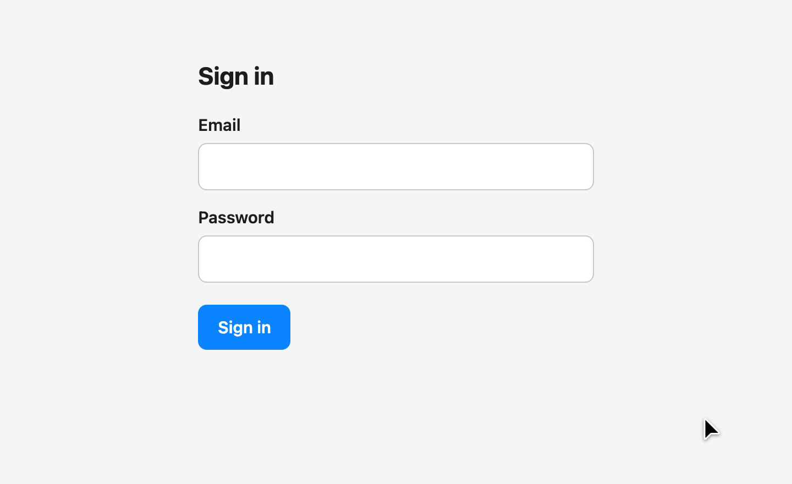

# iCloud Passwords for Chrome

Fill iCloud Keychain passwords in Chrome, Brave and other Chromium browsers on macOS.



## Install

```sh
npm install
npm run build
```

1. Open the browser's extensions page (e.g. `chrome://extensions`), enable Developer mode, Load unpacked, pick `dist/`.
2. Click the toolbar icon (⌘⇧L) and type the code macOS shows. This repeats once per browser launch.

## Features

- Saved logins in a menu on login fields
- Password generation
- Verification codes from the Passwords app and Messages, plus Gmail or the Mail app if you turn them on
- Offers to save new logins
- Popup to fill, copy or generate a password

Touch ID prompts come from macOS; turn them off under System Settings →
Touch ID & Password → Password AutoFill.

## Compared with Apple's extension

Apple's extension re-asks for the pairing code every few hours, puts an
"Enable AutoFill" balloon on every field, and lags on busy pages.

This one pairs once per browser launch, only shows a menu on login and code fields,
and does nothing until you focus one.

## Email codes

Apple's helper only passes on codes from Messages, so email is read directly.
Both sources are off by default; turn them on in Options (gear in the popup).

- Gmail: the inbox feed of the account the browser is signed in to.
- Mail app: a script that asks Mail for the last ten minutes of messages. Register it once with `npm run install-host`; macOS then asks once to let osascript control Mail.

## Browsers

Chrome and Brave work as is. Edge, Vivaldi, Arc and Opera need the helper's
manifest linked into their own directory:

```sh
ln -s /Library/Google/Chrome/NativeMessagingHosts/com.apple.passwordmanager.json \
  "/Library/Application Support/Chromium/NativeMessagingHosts/"
```

Unsigned Chromium builds don't work; Apple's helper only runs under browsers it
allowlists.

## Limitations

- Windows isn't currently supported.
- It's not on the Chrome Web Store because the helper only talks to Apple's
  extension ID, so the manifest reuses Apple's key and can't be published.

---

Protocol worked out from Apple's extension and
[au2001/icloud-passwords-firefox](https://github.com/au2001/icloud-passwords-firefox).
Apache-2.0.
